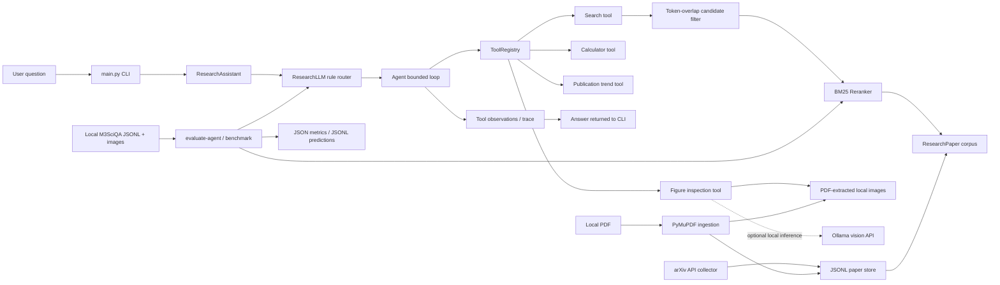
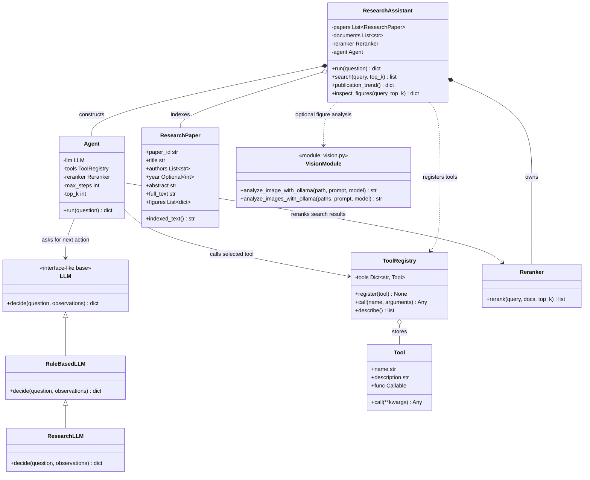
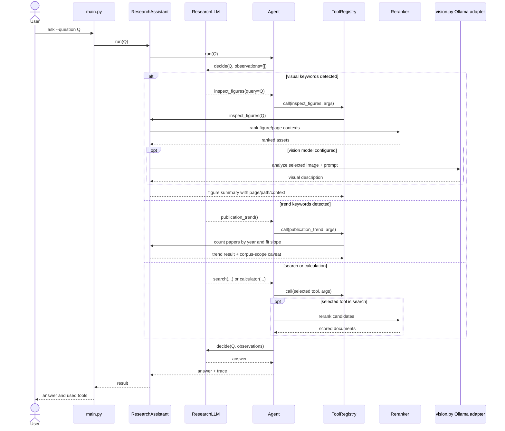
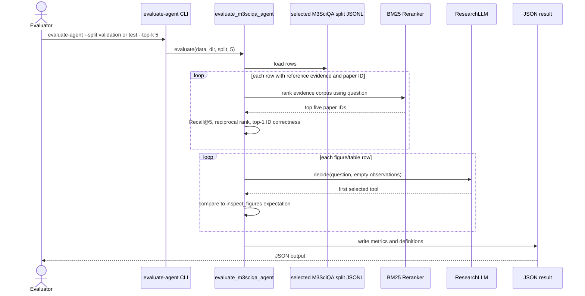

# Research Assistant Architecture

This document models the current `llm_agents` implementation. It describes the implemented system rather than an aspirational LLM architecture: tool routing is deterministic and rule-based; no hosted LLM or agent framework is required.

## System Boundary

The project has two related but distinct flows:

1. Interactive research: arXiv paper records are collected or PDFs are ingested, indexed as text, and queried through a bounded tool loop. The current local arXiv corpus has battery-degradation/cycle-life search results; the no-argument CLI demo still uses a small generic RAG sample corpus.
2. Offline evaluation: the benchmark runner uses M3SciQA annotations to measure retrieval, citation-ID matching, and routing. M3SciQA inference can also send local images to **Ollama**, but that inference path is separate from the text agent loop.

The project does not include or have local access to the NASA PCoE battery dataset. An attempted archive download was incomplete and unusable; it is not part of the project data. Consequently, no battery lifetime regression experiment or score is claimed.

Dashed Ollama usage is optional. The M3SciQA evaluator's calls to the vision model do not pass through `Agent`; the separate interactive `inspect_figures` tool does.

## UML Class Model

`LLM` is an interface-like base class; `RuleBasedLLM` and `ResearchLLM` make decisions. The registry stores callable tool wrappers, not independent autonomous agents. `ResearchAssistant` creates `Agent` and registers closures/methods for retrieval, trends, and figure inspection.

## Interactive Question Sequence

The loop is bounded by `Agent.max_steps`. `Agent` appends each tool's name, arguments, and result to `trace`; search results are BM25 reranked after tool execution. The current rule-based router makes one primary tool selection; it does not yet plan arbitrary multi-step workflows or invoke a generative answer model.

## Evaluation Flow

The candidate evidence corpus is formed from the selected split's public `evidence_reference` annotations grouped by `reference_arxiv_id`; answer and explanation fields are excluded. Because reference annotations create the candidate evidence set, this evaluation measures ranking within annotated evidence, not open-corpus retrieval. The validation split has answer labels; the test split does not. The four annotation-based retrieval/routing metrics can run on both splits, but answer correctness or answer-generation EM/F1 cannot be scored on test.

## Storage and Data Flow

- `papers.py` discovers arXiv metadata, normalizes paper records, serializes JSONL, and ingests local PDFs with PyMuPDF.
- `ResearchPaper.indexed_text()` combines paper metadata, abstract/full text, figure context, and source URL into a searchable string.
- `ResearchAssistant` builds its in-memory searchable document list from paper records.
- `_retrieve()` performs first-stage token-overlap filtering; `Reranker` scores and sorts candidates with BM25.
- `benchmark.py` handles SciFact and M3SciQA dataset/evaluation operations; `evaluation.py` computes the four agent-evaluation metrics.
- Local corpora and extracted images live under `data/`; metric outputs live under `results/`. Existing dataset files are not changed by the evaluation commands.

## Design Choices and Limitations

- **Small, inspectable runtime:** arXiv collection and JSON/XML processing use the Python standard library; PyMuPDF handles PDFs; BM25 and tokenization are implemented locally. This keeps setup modest, but there is no sentence-transformer embedding model or FAISS index.
- **Bounded tool orchestration:** `Agent` applies a maximum-step loop and records tool calls/results in a trace. The trace is useful for debugging and evaluation; tool failures are not yet normalized into a structured retry/abstention policy.
- **Deterministic tool selection:** `ResearchLLM` routes using explicit regex/keyword cues instead of model tool-calling. This is easy to reproduce but brittle: measured tool-selection accuracy is 0.3407 on validation and 0.3560 on test under the benchmark's visual-tool label rule.
- **Two-stage lexical retrieval:** `_retrieve()` first filters by token overlap, then BM25 ranks candidates. This is lightweight, but a relevant document with no shared query tokens is lost before BM25; no dense retrieval or vector-only/hybrid ablation has been run.
- **Citation scope:** interactive retrieval returns source identifiers/URLs with the selected evidence text. The M3SciQA citation metric only checks whether the top-ranked arXiv ID equals `reference_arxiv_id`; it does not judge whether the text entails the answer. The M3SciQA retrieval corpus is formed from annotated `evidence_reference` passages, so its Recall/MRR results measure ranking within annotated evidence, not open-corpus retrieval.
- **Multimodal boundary:** PDF ingestion extracts selectable text and embedded raster images; optional page rendering captures vector content. Scanned PDFs have no OCR. Interactive figure inspection can request a local Ollama description, but the default deterministic agent does not synthesize a complete, multi-paper, evidence-cited answer from the vision output.
- **Evaluation labels:** M3SciQA validation has answer labels, while the public test answers are blank/hidden. Test retrieval, ID-match, and routing metrics are calculable from released annotations; EM/F1 or answer correctness is not. Never interpret empty-reference test scores as zero model quality.
- **Local data and vision privacy:** the M3SciQA corpus/images are local. When Ollama vision is enabled, image bytes go to the configured local Ollama service; arXiv collection requires network access. No remote model API is used by the default deterministic agent.
