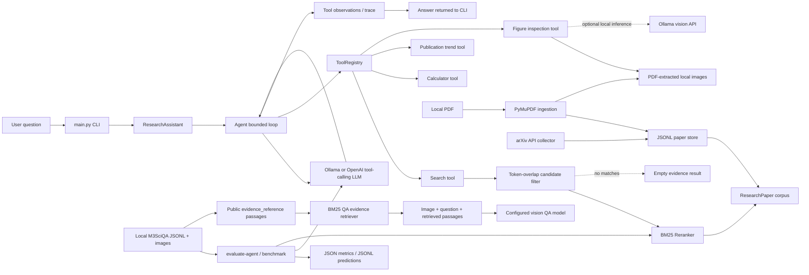
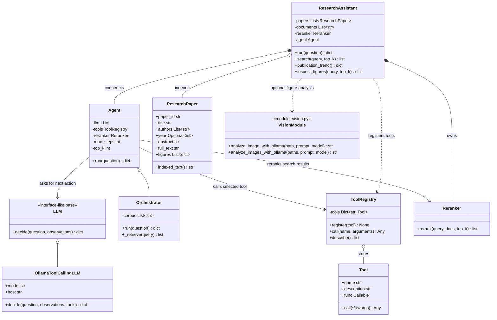
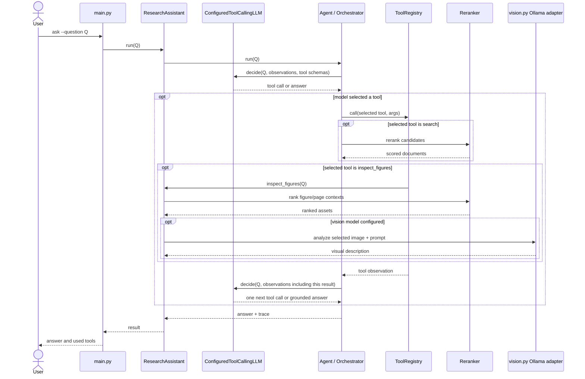
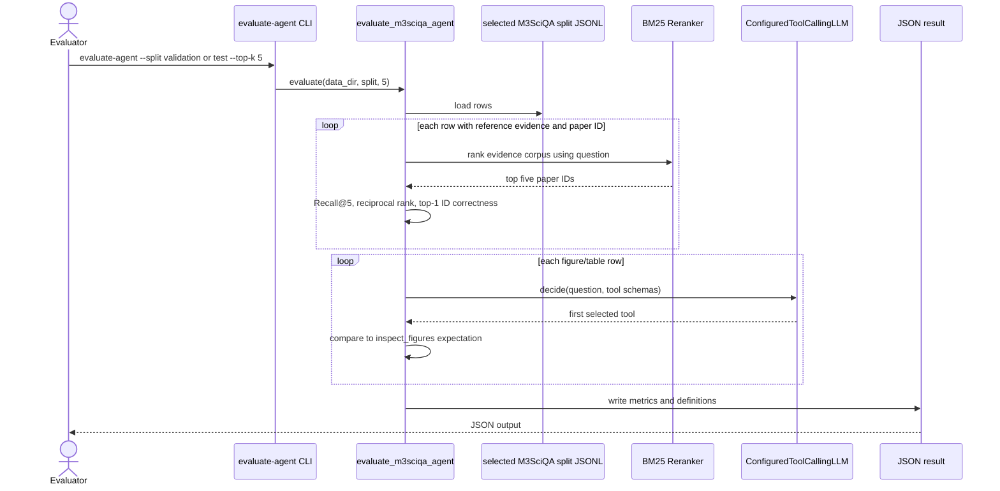

# Research Assistant Architecture

This document models the current `llm_agents` implementation. A bounded agent loop can use native tool calling from either a local Ollama model or an OpenAI GPT model. The selected provider controls whether questions/tool results stay local or are sent to a hosted API.

## System Boundary

The project has two related but distinct flows:

1. Interactive research: arXiv paper records are collected or PDFs are ingested, indexed as text, and queried through a bounded tool loop. The current local arXiv corpus has battery-degradation/cycle-life search results; the no-argument CLI demo still uses a small generic RAG sample corpus.
2. Offline evaluation: the benchmark runner uses M3SciQA annotations to measure retrieval and citation-ID matching, and asks the configured LLM to choose tools. Image-grounded QA retrieves public `evidence_reference` passages with BM25 and supplies the passages, paper IDs, question, and image to the selected vision model. The GPT validation run uses hosted **OpenAI** only; Ollama remains an optional, separate local provider.

The project does not include or have local access to the NASA PCoE battery dataset. An attempted archive download was incomplete and unusable; it is not part of the project data. Consequently, no battery lifetime regression experiment or score is claimed.

Dashed Ollama usage is optional. The M3SciQA evaluator's calls to the vision model do not pass through `Agent`; the separate interactive `inspect_figures` tool does.

The multimodal QA benchmark groups public `evidence_reference` passages by `reference_arxiv_id`, retrieves up to `--rag-top-k` positive-scoring passages for each question, and includes them with their arXiv IDs in the prompt. Answer and explanation labels are excluded. This is annotation-assisted RAG evaluation within M3SciQA, not open-corpus retrieval over collected PDFs.

## UML Class Model

`LLM` is an interface-like base class; the Ollama and OpenAI implementations use the configured model and registry JSON schemas to choose one next tool action or return an answer. `Orchestrator` inherits the adaptive `Agent` loop directly and supplies corpus retrieval; `ResearchAssistant` separately creates an `Agent` and registers retrieval, trend, calculator, and figure-inspection tools. The registry stores callable tool wrappers, not independent autonomous agents.

## Interactive Question Sequence

The loop is bounded by `Agent.max_steps` tool actions. Every decision chooses at most one action; after executing it, the agent passes the full observation trace to the LLM before asking for the next action. This allows later choices to adapt to earlier results instead of following a preplanned tool sequence. The agent permits one final model decision after the action budget is consumed, so it can synthesize an answer from the last observation but cannot call another tool. Batched tool calls are rejected. Search results are BM25 reranked after execution. If token-overlap filtering finds no candidates, search returns an empty list rather than the unrelated corpus. The LLM is instructed to identify missing or conflicting evidence, but this is not calibrated abstention or guaranteed conflict resolution; generated claims are not independently entailment-checked.

## Evaluation Flow

The candidate evidence corpus is formed from the selected split's public `evidence_reference` annotations grouped by `reference_arxiv_id`; answer and explanation fields are excluded. Because reference annotations create the candidate evidence set, this evaluation measures ranking within annotated evidence, not open-corpus retrieval. The validation split has answer labels; the test split does not. The four annotation-based retrieval/routing metrics can run on both splits, but answer correctness or answer-generation EM/F1 cannot be scored on test.

## Storage and Data Flow

- `papers.py` discovers arXiv metadata, normalizes paper records, serializes JSONL, and ingests local PDFs with PyMuPDF.
- `ResearchPaper.indexed_text()` combines paper metadata, abstract/full text, figure context, and source URL into a searchable string.
- `ResearchAssistant` builds its in-memory searchable document list from paper records.
- `_retrieve()` performs first-stage token-overlap filtering; `Reranker` scores and sorts candidates with BM25.
- `benchmark.py` handles M3SciQA dataset/evaluation operations; `evaluation.py` computes the four agent-evaluation metrics.
- Local corpora and extracted images live under `data/`; metric outputs live under `results/`. Existing dataset files are not changed by the evaluation commands.

## Design Choices and Limitations

- **Small, inspectable runtime:** arXiv collection and JSON/XML processing use the Python standard library; PyMuPDF handles PDFs; BM25 and tokenization are implemented locally. This keeps setup modest, but there is no sentence-transformer embedding model or FAISS index.
- **Adaptive tool orchestration:** `Agent` asks the LLM for one next action, executes it, and supplies its result before the next decision. A maximum action budget bounds execution, while a final decision can synthesize an answer after the budget. Unsupported, malformed, or batched calls raise an error; no automatic retry policy is implemented.
- **LLM tool selection:** Ollama and OpenAI implementations receive function schemas from `ToolRegistry`. Results depend on model and prompt. The saved 0.3407/0.3560 scores are from the former keyword router. The pre-adaptive GPT run scored 0.1615 first-tool accuracy with three errors; the fresh run after sequential replanning scored 0.0996 strict first-tool accuracy (45/452 correct, zero recorded tool-call errors). The benchmark evaluates only the first choice per row, not later replanning. See the [fresh tool-calling metrics](../results/tool-calling/validation/agentic-run-2026-10-31/metrics.json).
- **Two-stage lexical retrieval:** `_retrieve()` filters by token overlap, then BM25 ranks candidates. No overlap yields an empty result, enabling the LLM to recognize missing evidence; relevant documents without shared query terms can still be missed. No dense retrieval or vector-only/hybrid ablation has been run.
- **Citation scope:** interactive retrieval returns source identifiers/URLs with the selected evidence text. The M3SciQA citation metric only checks whether the top-ranked arXiv ID equals `reference_arxiv_id`; it does not judge whether the text entails the answer. The M3SciQA retrieval corpus is formed from annotated `evidence_reference` passages, so its Recall/MRR results measure ranking within annotated evidence, not open-corpus retrieval.
- **Multimodal boundary:** PDF ingestion extracts selectable text and embedded raster images; optional page rendering captures vector content. Scanned PDFs have no OCR. Interactive figure inspection can request a local Ollama vision description; answer grounding and cross-paper visual reasoning are not independently verified.
- **Evaluation labels:** M3SciQA validation has answer labels, while the public test answers are blank/hidden. Test retrieval, ID-match, and routing metrics are calculable from released annotations; EM/F1 or answer correctness is not. Never interpret empty-reference test scores as zero model quality.
- **Evidence robustness:** prompts instruct the LLM to state when support is missing or sources conflict. This is instruction-level guidance, not a contradiction detector or calibrated abstention mechanism, and has not been validated on a dedicated robustness set.
- **Provider and data privacy:** with Ollama, questions, tool results, and optional vision images are sent to the local service. With OpenAI, agent questions/tool results or vision images are sent to the hosted API. arXiv collection and dataset download require network access.
